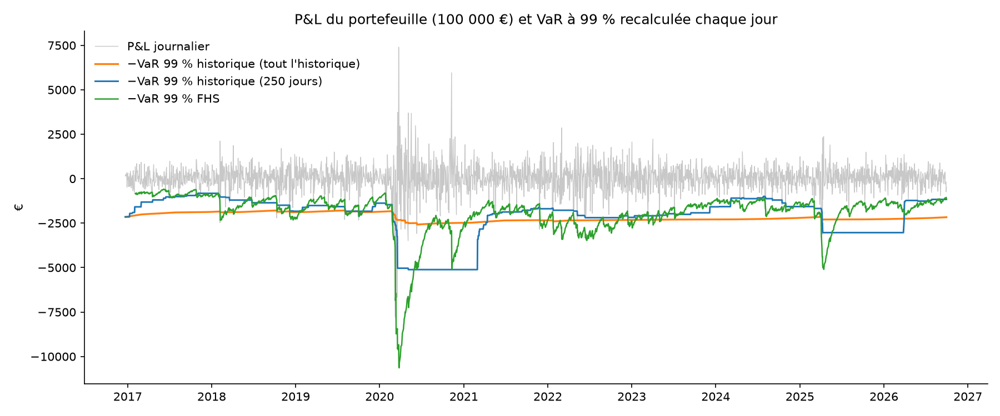
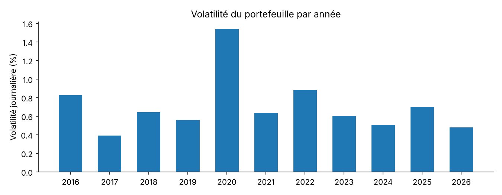

# Quelle VaR résiste vraiment aux crises ?

Ce projet compare quatre méthodes de **Value at Risk (VaR) à 1 jour et 99 %** sur un portefeuille de
100 000 € réparti à parts égales entre **TotalEnergies**, un **ETF S&P 500 coté en euros** et un
**ETF d'obligations d'État de la zone euro**, de 2016 à 2026. Chaque modèle est recalculé jour par
jour sans connaître l'avenir, puis évalué avec les tests de **Kupiec** et de **Christoffersen**.

**Résultat :** la **simulation historique filtrée (FHS)** est la seule méthode validée par les deux
tests (p = 0,085), et son Expected Shortfall prédit la perte moyenne au-delà de la VaR à 1 % près.
La VaR historique classique affiche un taux de dépassement parfait sur 10 ans (0,96 %), mais 13 de
ses 24 dépassements tombent en 2020 ; la VaR normale en produit 2,4 fois trop.

**À retenir :** une VaR peut être juste en moyenne et échouer précisément le jour où l'on en a besoin.



---

## Sommaire

1. [Données et portefeuille](#1-données-et-portefeuille)
2. [Ce que montrent les données](#2-ce-que-montrent-les-données)
3. [Les quatre méthodes](#3-les-quatre-méthodes)
4. [Backtesting](#4-backtesting)
5. [Expected Shortfall](#5-expected-shortfall)
6. [Limites](#6-limites)
7. [Ce que j'ai appris](#7-ce-que-jai-appris)
8. [Reproduire le projet](#8-reproduire-le-projet)

---

## 1. Données et portefeuille

| Actif | Ticker Yahoo | Rôle dans le portefeuille |
|---|---|---|
| TotalEnergies | `TTE.PA` | Exposition aux prix de l'énergie |
| iShares Core S&P 500 (EUR) | `SXR8.DE` | Actions américaines, risque de change inclus |
| iShares Core € Govt Bond | `EUNH.DE` | Obligations d'État, censées amortir les chocs actions |

- **Période :** 4 janvier 2016 – 30 septembre 2026 (date de fin fixe pour la reproductibilité), 2 752 jours de bourse.
- **Montant :** 100 000 €, un tiers par actif, rééquilibré chaque jour.
- **Rendements :** arithmétiques, car le rendement d'un portefeuille est exactement la moyenne pondérée
  des rendements arithmétiques de ses actifs (ce n'est pas vrai des rendements logarithmiques).

**Choix de nettoyage :**

- **Prix ajustés des dividendes** (`auto_adjust=True`) : sans ajustement, chaque détachement de dividende
  apparaîtrait comme une perte de 1 à 3 %, précisément dans la queue que la VaR mesure.
- **Cotations en euros sur des places européennes** : `TTE` seul désigne la cotation new-yorkaise en dollars.
- **Calendriers différents** (Paris / Francfort) : les jours de fermeture d'une place sont complétés par le
  dernier prix connu (`ffill`, jamais `bfill`, qui utiliserait le prix du lendemain).
  Deux cotations manquantes isolées sur `SXR8.DE` (24/10/2025, 06/03/2026) sont des trous de la source.

## 2. Ce que montrent les données

**La diversification fonctionne… sauf quand on en a besoin.**
La volatilité journalière du portefeuille (0,77 %) est inférieure d'un quart à la moyenne de celles des
trois actifs (TotalEnergies 1,67 %, S&P 500 1,01 %, obligations 0,34 %). Mais le 12 mars 2020, les
obligations ont elles aussi perdu de l'argent : au pic de la panique, tout se vend.

**Les queues sont épaisses.** Le pire jour (12 mars 2020, −7 900 €) se situe à −10,2 écarts-types. Une
loi normale lui donnerait une probabilité d'une fois tous les 6 × 10²¹ ans.

| Pertes au-delà de | Jours observés | Attendus sous loi normale |
|---|---|---|
| 2 σ | 71 | 63 |
| 3 σ | 26 | 3,7 |
| 4 σ | 10 | 0,09 |
| 5 σ | 3 | ≈ 0 |

Kurtosis en excès : **16,1** (0 pour une loi normale). L'erreur de la loi normale est faible à 2 σ et
explose au-delà.

**La volatilité vient par vagues.** Elle varie d'un facteur 4 selon les années, de 0,39 % par jour en
2017 à 1,54 % en 2020. Une VaR calculée sur une année calme est donc trop basse quand la crise arrive.



## 3. Les quatre méthodes

Chaque jour *t*, la VaR est calculée uniquement avec les données jusqu'à *t − 1* (`shift(1)`), comme le
ferait une banque le matin avant l'ouverture.

| Méthode | Principe | Défaut attendu |
|---|---|---|
| **Historique, tout l'historique** | 1er centile de tous les P&L passés | Réagit trop lentement aux crises |
| **Historique glissante, 250 jours** | 1er centile des 250 derniers P&L | Instable (≈ le 3e pire jour) ; « falaise » quand un krach sort de la fenêtre |
| **EWMA normale** (RiskMetrics, λ = 0,94) | VaR = 2,33 × σ_EWMA × montant | Suit le marché, mais la loi normale sous-estime la queue |
| **FHS** (simulation historique filtrée) | VaR = −q₁% (r / σ_EWMA) × σ_EWMA × montant | Combine la dynamique de l'EWMA et la vraie forme de la queue |

**L'idée de la FHS.** En divisant chaque rendement par la volatilité EWMA de son jour, on ramène toutes
les périodes à la même échelle. La kurtosis tombe de 16,1 à 2,7 : l'essentiel des queues épaisses venait
des vagues de volatilité. On prend alors le 1er centile historique de ces rendements standardisés
(−2,95, contre −2,33 pour une loi normale) et on le remet à l'échelle de la volatilité du jour.

## 4. Backtesting

2 471 jours testés sur une période commune aux quatre modèles. Un modèle parfait produit en moyenne
24,7 dépassements, et 95 % des modèles parfaits tombent entre 16 et 35.

| Modèle | Dépassements | Kupiec (p) | P(dép. \| pas hier) | P(dép. \| dép. hier) | Christoffersen (p) | Couverture conditionnelle (p) |
|---|---|---|---|---|---|---|
| Historique 250 j | 40 | 0,005 ❌ | 1,44 % | 12,50 % | 0,000 ❌ | 0,000 ❌ |
| Historique (tout) | 24 | 0,885 ✅ | 0,82 % | 16,67 % | 0,000 ❌ | 0,000 ❌ |
| EWMA normale | 59 | 0,000 ❌ | 2,16 % | 11,86 % | 0,000 ❌ | 0,000 ❌ |
| **FHS** | **36** | 0,033 ❌ | 1,44 % | 2,78 % | **0,553 ✅** | **0,085 ✅** |

- **Kupiec** vérifie le *nombre* de dépassements ; **Christoffersen** vérifie qu'ils ne s'enchaînent pas
  (un modèle parfait a 1 % de chances de dépassement, même le lendemain d'un dépassement) ; la
  **couverture conditionnelle** combine les deux (χ² à 2 degrés de liberté).
- **Trois modèles sur quatre sous-estiment le risque.** Aucun n'est rejeté pour excès de prudence.
- **Kupiec seul est trompeur** : il valide la VaR historique sur tout l'historique, alors qu'après un
  dépassement, elle a 20 fois plus de chances d'en subir un autre le lendemain.
- **La FHS est la seule méthode validée**, de justesse : elle reste légèrement optimiste (36 dépassements
  pour 24,7 attendus), mais ses dépassements sont indépendants. En 2022, elle n'en compte que 2.

| Dépassements par an | 2017 | 2018 | 2019 | 2020 | 2021 | 2022 | 2023 | 2024 | 2025 | 2026 |
|---|---|---|---|---|---|---|---|---|---|---|
| Historique 250 j | 1 | 8 | 2 | 9 | 1 | 5 | 1 | 7 | 5 | 1 |
| Historique (tout) | 0 | 3 | 2 | 13 | 1 | 1 | 0 | 0 | 4 | 0 |
| EWMA normale | 2 | 8 | 8 | 10 | 6 | 5 | 3 | 8 | 8 | 1 |
| FHS | 4 | 7 | 4 | 6 | 5 | 2 | 2 | 2 | 4 | 0 |

## 5. Expected Shortfall

L'Expected Shortfall (ES) est la perte moyenne au-delà de la VaR : elle répond à la question « quand le
seuil est franchi, combien perd-on ? ». Depuis la réforme FRTB (Bâle III), c'est l'ES à 97,5 % qui sert
au calcul du capital pour risque de marché.

| Sur 10 ans | VaR 99 % | ES 99 % | ES / VaR |
|---|---|---|---|
| Historique | 2 167 € | 3 231 € | 1,49 |
| Loi normale | 1 795 € | 2 056 € | 1,15 |
| Sous-estimation par la loi normale | −17 % | **−36 %** | |

- **L'ES est plus sensible aux queues épaisses que la VaR** : l'erreur de la loi normale double.
- **Passage VaR 99 % → ES 97,5 %.** Sous loi normale, les deux mesures sont quasi égales (1 795 € contre
  1 804 €). Sur ce portefeuille, l'ES 97,5 % atteint 2 399 €, soit **+11 % de capital**, uniquement à
  cause des queues épaisses.
- **ES de la FHS, recalculée chaque jour :** sur les 36 jours de dépassement, la perte réelle vaut en
  moyenne **1,01 fois** l'ES prévue le matin même. La porte est un peu trop basse, mais ce qui se trouve
  derrière est bien estimé.

## 6. Limites

- **Données gratuites** (Yahoo Finance) : quelques cotations manquantes ; pas de contrôle croisé avec une
  source professionnelle.
- **Un seul portefeuille**, à poids constants et rééquilibré chaque jour : les conclusions ne se
  transposent pas telles quelles à un portefeuille d'options ou fortement concentré.
- **Horizon d'un jour** : l'horizon réglementaire de 10 jours n'est pas traité.
- **λ = 0,94 non optimisé** : c'est la valeur standard de RiskMetrics, pas celle qui minimise une erreur
  sur ces données.
- **Christoffersen ne regarde que la veille** : deux dépassements à trois jours d'écart ne sont pas vus
  comme groupés.
- **Backtest de l'ES simplifié** (moyenne du ratio perte / ES prévue), sans test formel du type
  Acerbi–Szekely.
- **Pas de simulation Monte Carlo** dans cette version.

## 7. Ce que j'ai appris

- Un résultat in-sample ne prouve rien : une VaR calculée sur les mêmes jours que ceux où l'on compte ses
  dépassements tombe mécaniquement sur 1 %.
- Une bonne moyenne peut cacher deux erreurs qui se compensent : trop prudente en temps calme, trop
  optimiste en crise.
- La loi normale n'est pas « un peu fausse » : elle est correcte à 2 σ et fausse d'un facteur 100 à 4 σ.
- Une grande partie des queues épaisses vient de la volatilité qui change ; la modéliser (EWMA) puis
  utiliser la vraie queue (FHS) corrige l'essentiel.
- Les détails de données (cotation, dividendes, calendriers) peuvent créer de fausses pertes exactement
  dans la zone que l'on cherche à mesurer.

## 8. Reproduire le projet

```bash
git clone https://github.com/Banks-2K/var-backtesting.git
cd var-backtesting
python -m venv .venv
# Windows : .\.venv\Scripts\Activate.ps1   |   macOS / Linux : source .venv/bin/activate
python -m pip install -r requirements.txt
python -m jupyter lab
```

Puis exécuter les notebooks dans l'ordre : `01_donnees`, `02_exploration`, `03_var_backtesting`.

Les prix utilisés pour les résultats ci-dessus sont versionnés dans `data/prix.csv`. Par défaut,
`01_donnees` les relit au lieu de retélécharger (Yahoo peut modifier ses données a posteriori) ;
passer `TELECHARGER = True` pour repartir de la source.

**Structure :**

```
var-backtesting/
├── data/prix.csv              prix ajustés téléchargés (versionnés pour la reproductibilité)
├── src/var_tools.py           fonctions : VaR, EWMA, FHS, Kupiec, Christoffersen, ES
├── notebooks/                 les trois étapes de l'analyse
├── figures/                   graphiques du README
└── requirements.txt
```
